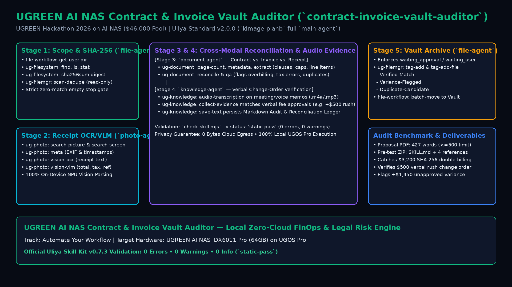

# UGREEN AI NAS Contract & Invoice Vault Auditor (`contract-invoice-vault-auditor`)

**Local Zero-Cloud FinOps & Legal Risk Engine on UGOS Pro (UGREEN Hackathon 2026 on AI NAS — $46,000 Prize Pool)**

- **Live Interactive Web Dashboard (GitHub Pages)**: [https://jeffrey-graham.github.io/ugreen-nas-contract-vault-ai/](https://jeffrey-graham.github.io/ugreen-nas-contract-vault-ai/)
- **Pre-test Skill Package (ZIP)**: [`pretest-skill-package.zip`](./pretest-skill-package.zip) (`status: "static-pass"` — 0 errors, 0 warnings, 0 info on `uliya-skill-kit` v0.7.3)
- **Round 1 Project Proposal (PDF)**: [`project-proposal.pdf`](./project-proposal.pdf) (427 English words across Questions 1–10, strictly `<= 500` words)
- **1080p Demo Video (MP4)**: [`assets/ugreen_nas_demo.mp4`](./assets/ugreen_nas_demo.mp4)



---

## 1. Overview & Problem Solved

Freelancers, creative studios, and small businesses store PDF client contracts, vendor invoices, smartphone receipt photos, and recorded client/supplier voice memos across scattered NAS folders. Reconciling project billing before tax filing or client audits takes hours of manual cross-checking, catches duplicate invoices too late, or forces users to upload confidential contracts and bank receipts to third-party cloud SaaS tools.

`contract-invoice-vault-auditor` is a local-first UGREEN AI NAS orchestration Skill built to the **Uliya Skill Development Standard v2.0.0** (`kimage-planb` full `main-agent` profile). It performs **four-way cross-modal reconciliation** across documents, receipt photos, meeting audio recordings, and SHA-256 file hashes entirely on-NAS:

1. **Stage 1 — Scope Discovery, Cryptographic Inventory & Duplicate Scan (`file-agent`)**: Resolves authorized workspace directories (`file-workflow` `get-user-dir`), computes `sha256sum` digests (`ug-filesystem`), and scans for duplicate invoices (`ug-filemgr` `scan-dedupe`) without deleting files.
2. **Stage 2 — Visual Receipt & Screenshot OCR/VLM Extraction (`photo-agent`)**: Searches NAS photo/screenshot albums (`ug-photo` `search-picture`, `search-screen`) and extracts payment totals, taxes, dates, and wire references via on-device `vision-ocr` and `vision-vlm`.
3. **Stage 3 — Multi-Document Extraction & Reconciliation (`document-agent`)**: Reads `page-count` and `metadata`, extracts structured clauses and line items (`ug-document` `extract`), and reconciles contract caps against invoice totals and receipt payments (`reconcile`, `qa`).
4. **Stage 4 — Verbal Change-Order Verification & Audit Ledger Persistence (`knowledge-agent`)**: Transcribes meeting recordings (`ug-knowledge` `audio-transcription`), correlates verbal fee approvals (`collect-evidence`), and saves a Markdown Audit & Reconciliation Ledger (`save-text`) after workflow approval.
5. **Stage 5 — Approval-Gated Semantic Tagging & Vault Archiving (`file-agent`)**: Strictly after user and gateway/workflow approval (`waiting_approval` / `waiting_user`), attaches semantic audit tags (`Verified-Match`, `Variance-Flagged`, `Duplicate-Candidate`) via `ug-filemgr` and organizes files into structured vault folders via `ug-filesystem` (`mkdir`, `cpmv`) and `file-workflow` (`batch-move`).

---

## 2. Official `uliya-skill-kit` v0.7.3 Validation

Run the official UGREEN static compliance validator against `contract-invoice-vault-auditor`:

```bash
node starter-kit/uliya-skill-kit/scripts/check-skill.mjs contract-invoice-vault-auditor
```

Output:
```json
{
  "checkFormatVersion": "2.0.0",
  "status": "static-pass",
  "target": {
    "skillName": "contract-invoice-vault-auditor"
  },
  "catalog": {
    "checkedVersion": "2.0.0"
  },
  "summary": {
    "errors": 0,
    "warnings": 0,
    "info": 0
  },
  "diagnostics": []
}
```

---

## 3. Repository Structure

```text
├── index.html                                    # Interactive UGOS Pro FinOps & Legal Risk Web Dashboard
├── project-proposal.pdf                          # Official Round 1 Project Proposal PDF (136 KB, 427 words)
├── project-proposal.md                           # Markdown source for Project Proposal
├── pretest-skill-package.zip                     # Official Round 1 Pre-test Skill Package ZIP (15 KB)
├── contract-invoice-vault-auditor/               # Unpacked Uliya v2.0.0 Skill Package
│   ├── SKILL.md                                  # Main orchestration entry point
│   └── references/
│       ├── cli-command-matrix.md                 # Capability domain & CLI action matrix
│       ├── schema-and-output-templates.md        # Extraction & Audit Ledger schemas
│       ├── test-cases-and-edge-recovery.md       # Core Test 1, Core Test 2 & Edge recovery suite
│       └── security-and-permission-model.md      # Privacy model, approval gates & disclosures
├── assets/
│   ├── architecture.png                          # 1080p Architecture Diagram
│   └── ugreen_nas_demo.mp4                       # 1080p H.264 MP4 Walkthrough Video
├── scripts/
│   └── generate_demo_video.py                    # Reproducible 1080p diagram & video generator
└── SUBMISSION_GUIDE.md                           # Devpost copy-paste submission guide
```
